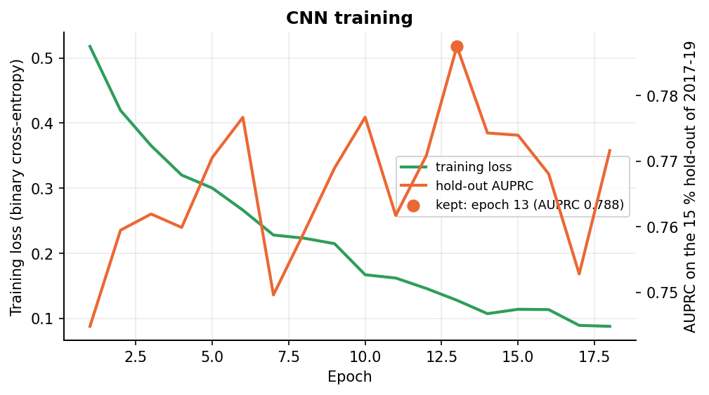
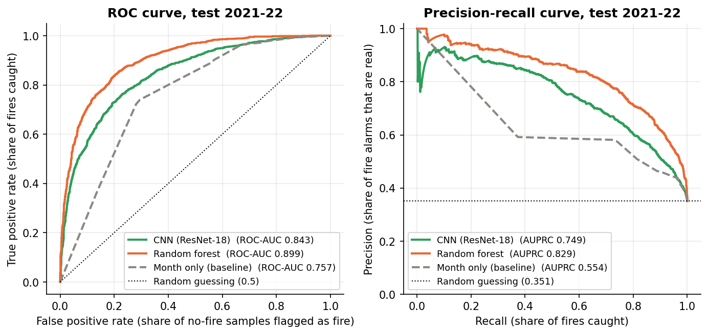
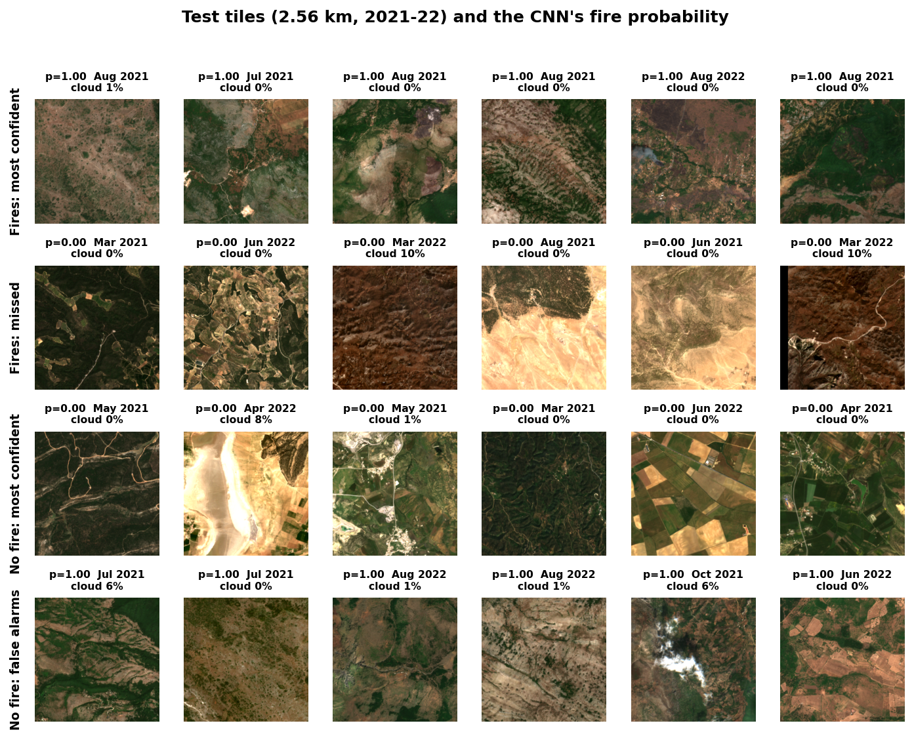

# Image branch: CNN on the Sentinel-2 tiles

First results of the image branch: a **ResNet-18** (ImageNet weights, fine-tuned end to end)
that predicts fire / no fire from the 2.56 km Sentinel-2 RGB tile of each sample. Same
samples, years and metrics as the tabular models (`reports/tabular/README.md`), so the two
branches are directly comparable and fusion can join them by `sample_id`.

> **In one paragraph.** On the 2021-22 test years the CNN reaches **AUPRC 0.749** (ROC-AUC
> 0.843, F1 0.695): clearly better than logistic regression on the tabular features (0.710) and
> clearly below the random forest (0.829). Season-matched it keeps **AUPRC 0.705** (chance
> 0.351), and it loses less to season matching than the random forest does (-0.04 vs -0.10),
> so the image carries fire-danger signal that is not just "it looks like summer". The model
> overfits quickly (training loss 0.09 after 18 epochs while the hold-out score plateaus around
> 0.77), which is the first thing to improve. The cloudy-tile rule from the tabular branch
> (drop scenes with > 20 % cloud) is confirmed; within the remaining tiles the CNN does not score
> by cloud cover alone.

## 1. Files and how to reproduce

| File | What it is |
|---|---|
| `metrics.csv` | Test scores, `standard` and `season_matched`, same columns as the tabular `metrics.csv` |
| `predictions.csv` | **For fusion.** `p_cnn` for every 2020 (`split = val`) and 2021-22 (`split = test`) sample, by `sample_id` |
| `history.csv` | Training loss and hold-out AUPRC per epoch |
| `by_cloud.csv` | CNN and RF test scores per scene-cloud bucket (section 5) |
| `figures/` | The figures below |

```bash
python -m forest_fire_risk.cnn              # cache tiles (30 s), train (~7 min on a laptop GPU, 18 epochs), evaluate
python -m forest_fire_risk.cnn_figures      # figures + by_cloud.csv (needs reports/tabular/ too)
```

Code: `src/forest_fire_risk/cnn.py`, `cnn_figures.py`; test in `tests/test_cnn.py`. The tiles are
cached once as `data/tiles.npy` (2.3 GB, git-ignored); the weights go to `models/cnn/`
(git-ignored). Training is seeded, but GPU convolutions are not bit-reproducible, so a re-run
gives slightly different numbers (expect ±0.01 AUPRC).

## 2. Data, years and what the model sees

- **Samples:** the same 10,922 as the tabular branch: 2017-2022, a tile exists, scene cloud ≤ 20 %.
- **Years:** 2017-2019 train, **2020 untouched** (only predicted, for fusion), 2021-2022 test.
  Inside 2017-2019 a random, label-stratified **15 % (760 samples) is held out** to stop training
  early and to pick the decision threshold (the F1-maximising cut-off on the hold-out, 0.39).
  Leave-one-year-out CV, as used for the tabular models, would mean three CNN trainings per
  setting; one hold-out is the cheap equivalent for now.
- **Input:** the 256 x 256 RGB tile at 10 m (2.56 km around the cell), scaled to [0, 1] and
  normalised with the ImageNet statistics. The tile is the least-cloudy scene in the 15 days
  *before* the window's last day, so no smoke or burn scar of the fire itself is visible.
- **Augmentation:** random 90-degree rotations and horizontal flips (a satellite tile has no "up").
- **Model:** torchvision ResNet-18 pre-trained on ImageNet, last layer replaced by one logit;
  binary cross-entropy, AdamW (learning rate 1e-4, weight decay 1e-4), batch 64, up to 30 epochs,
  stopped after 5 epochs without a better hold-out AUPRC; the best epoch's weights are kept.
  No static features are fed to the CNN: that would blur the comparison with the tabular branch.

## 3. Training



**Figure 1.** Training loss (green, left axis) and hold-out AUPRC (orange, right axis) per epoch.
The loss keeps falling to 0.09, i.e. the network memorises the 4,306 training tiles, while the
hold-out score plateaus at 0.75-0.79 from epoch 5 on. Epoch 13 was kept. With only 760 hold-out
samples the epoch-to-epoch wiggle (±0.02) is mostly noise, so the choice of epoch is not very
meaningful: any epoch after 5 gives roughly the same model.

## 4. Results on the test years 2021-22

| Model | AUPRC | ROC-AUC | F1 | Precision | Recall | AUPRC season-matched | ROC-AUC season-matched |
|---|---|---|---|---|---|---|---|
| **CNN (ResNet-18)** | **0.749** | **0.843** | **0.695** | 0.656 | 0.738 | **0.705** | 0.810 |
| Random forest (tabular) | 0.829 | 0.899 | 0.758 | 0.691 | 0.839 | 0.731 | 0.831 |
| Logistic regression (tabular) | 0.710 | 0.819 | 0.673 | 0.579 | 0.804 | 0.604 | 0.736 |
| Month only (baseline) | 0.554 | 0.757 | 0.644 | 0.581 | 0.723 | 0.351 (chance) | 0.500 (chance) |



**Figure 2.** ROC (left) and precision-recall (right) curves on the test set. The random forest
is above the CNN at every operating point; the CNN is above the month-only baseline everywhere.
At 80 % recall, 62 % of the CNN's alarms are real against 71 % for the random forest.

**Reading the numbers.**
- The image alone gets a good part of the way: AUPRC 0.749 against 0.829 for 27 numeric
  drivers, and above the linear tabular model. Fuel type, vegetation density and terrain are
  visible in the tile; the weather of the day is not, which is a plausible reason for the gap.
- **Season matching costs the CNN less** (0.749 → 0.705) than the random forest
  (0.829 → 0.731) or logistic regression (0.710 → 0.604). The tabular models see temperature
  and radiation, which reveal the month directly; the image reveals it only through vegetation
  colour. So a larger share of the CNN's score is "which place burns", not "which time of year".
  That is the kind of complementary information fusion is meant to exploit.



**Figure 3.** Test tiles with the CNN's fire probability, scene month and scene cloud %. Row 1:
fires the model is surest about, mostly dry, sparsely vegetated summer landscapes with
scattered shrub. Row 2: fires it missed with p ≈ 0, several of them dark-red bare or recently
cleared ground and dense green forest in spring. Row 3: non-fires it is surest about, mostly
dark forest, farmland and water. Row 4: false alarms, which look like row 1 (dry summer shrub);
one has a cloud over it. The model has learned a "dry Mediterranean shrubland in summer" look;
it has no way to know whether a fire actually started there on that day.

## 5. Cloudy tiles: decision and check

**Decision for the tabular branch: keep `MAX_CLOUD = 20`.** The CNN drops the 657 tiles from
scenes with more than 20 % cloud, as the tabular models already do. Those tiles are 86 fires and
571 non-fires, so keeping them would hand the CNN an easy "clouds → no fire" shortcut.

**Does the CNN use cloud cover within the ≤ 20 % tiles?** Scores per scene-cloud bucket on the
test set (`by_cloud.csv`):

| Scene cloud | n | Share of fires | CNN mean p | RF mean p | CNN ROC-AUC | RF ROC-AUC | CNN AUPRC | RF AUPRC |
|---|---|---|---|---|---|---|---|---|
| 0-1 % | 2,572 | 0.41 | 0.41 | 0.40 | 0.845 | 0.890 | 0.795 | 0.844 |
| 1-5 % | 661 | 0.29 | 0.35 | 0.31 | 0.840 | 0.917 | 0.694 | 0.836 |
| 5-20 % | 525 | 0.15 | 0.22 | 0.22 | 0.777 | 0.876 | 0.421 | 0.584 |

The CNN's average probability falls with cloud cover, but so does the share of fires, and the
random forest (which never sees the image) shows the same pattern: cloudier scenes are simply
more often non-fire days. *Within* each bucket the CNN still separates fires from non-fires
(ROC-AUC 0.78-0.85, far from 0.5), so it is not scoring by cloud alone. It does lose more than
the random forest on the cloudiest bucket (ROC-AUC 0.78 vs 0.88), as one would expect when part
of the tile is hidden. AUPRC is not comparable across buckets because the fire share differs.

## 6. Hand-off to fusion

- `predictions.csv`, column `p_cnn`, joins to `reports/tabular/predictions.csv` (`p_rf`) on
  `sample_id`; both have exactly the same 2,098 val (2020) and 3,758 test (2021-22) rows.
- The CNN never trained or tuned on 2020 or 2021-22. Its hold-out predictions on the 760
  held-out training samples are in `models/cnn/train_holdout.csv` (git-ignored) if a
  second, smaller stacking set is ever needed.

## 7. Limitations and next steps

- **Overfitting.** Loss 0.09 against a flat hold-out curve. Cheap things to try, in order:
  freeze the early ResNet blocks, lower the learning rate, stronger augmentation (colour jitter,
  random crops), dropout before the last layer. Each is a one-line change in `cnn.py`.
- **Single hold-out, no cross-validation.** The threshold and the stopping epoch come from one
  random 15 % of 2017-19. Leave-one-year-out CV like the tabular branch would cost 3x the
  training time (~12 min) and is the honest next step before the final report.
- **RGB only.** Sentinel-2 also has near-infrared and short-wave infrared bands, which are the
  standard way to see vegetation moisture (NDVI, NBR). The tiles were pulled as RGB; re-pulling
  with those bands is a `gee_images.py` change and would likely help more than any architecture
  change.
- **Same caveats as the tabular branch:** same-day danger rather than a forecast, the same cells
  can appear in train and test years, seasonal sampling handled at evaluation time only.
