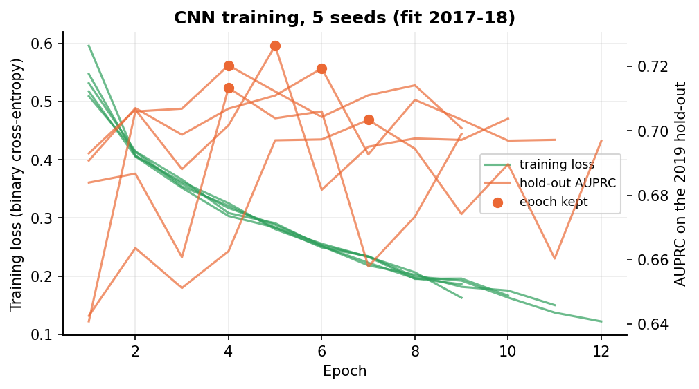
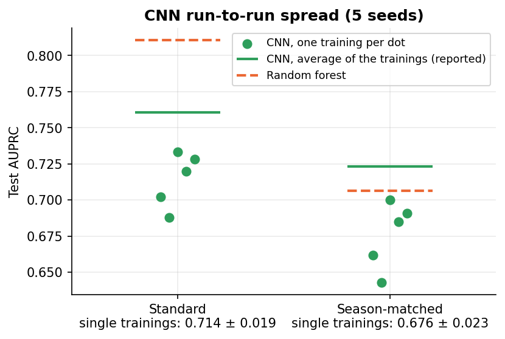
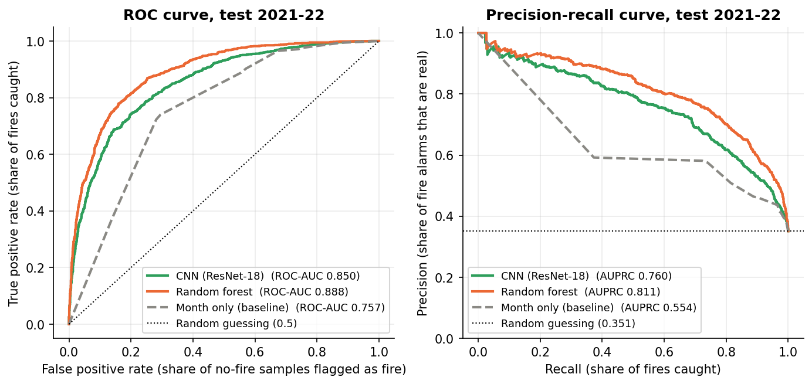
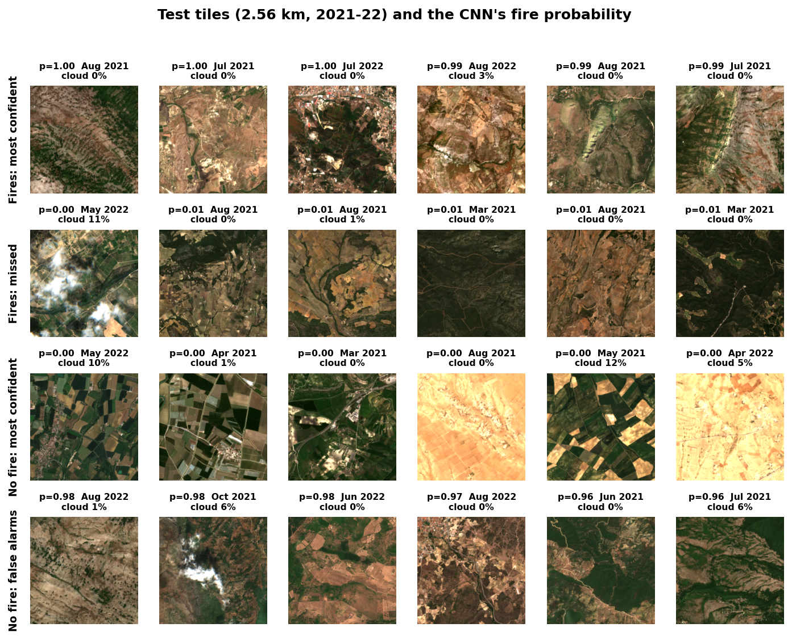

# Image branch: CNN on the Sentinel-2 tiles

A **ResNet-18** (ImageNet weights, fine-tuned end to end) that predicts fire / no fire from the
2.56 km Sentinel-2 RGB tile of each sample. Same samples, years and metrics as the tabular models
(`reports/tabular/README.md`), so the two branches are directly comparable and fusion can join
them by `sample_id`.

> **In one paragraph.** The reported CNN is the **average of five trainings** and reaches
> **AUPRC 0.760** on the 2021-22 test years (ROC-AUC 0.850, F1 0.696): above logistic regression
> on the tabular features (0.695), below the random forest (0.811). Season-matched it keeps
> **AUPRC 0.723** (chance 0.351), slightly *above* the random forest's 0.707, so the image carries
> fire-danger signal that is not just "it looks like summer". A single training is clearly weaker
> and noisy: **0.714 ± 0.019** over the five seeds (0.688 to 0.733). Freezing the early layers did
> not reduce the overfitting; early stopping on a held-out year and averaging the trainings do the
> work.

> **Changes since the progress report.** (1) The stopping epoch and the threshold now come from a
> held-out **year (2019)** instead of a random 15 % of 2017-19, and the model is then refit on all
> of 2017-19. (2) The CNN is trained **five times** with different seeds; every run is saved and
> the reported model is their average. (3) Freezing early ResNet blocks was tested and rejected.
> The single run in the progress report (0.749) was a lucky draw: its random hold-out scored
> 0.77-0.79 while the honest 2019 hold-out scores 0.70-0.73, which is what single trainings then
> get on the test years.

## 1. Files and how to reproduce

| File | What it is |
|---|---|
| `metrics.csv` | Test scores of the reported CNN (average of the trainings), `standard` and `season_matched` |
| `predictions.csv` | **For fusion.** `p_cnn` (average of the trainings) for every 2020 (`split = val`) and 2021-22 (`split = test`) sample, by `sample_id` |
| `runs.csv` | One row per training: seed, epochs, 2019 hold-out AUPRC, threshold and test scores |
| `predictions_runs.csv` | Same rows as `predictions.csv` with one column per training (`p_cnn_42` ... `p_cnn_46`), to refit fusion on each run |
| `history.csv` | Training loss and 2019 hold-out AUPRC per epoch and seed (step 1 of each training) |
| `freeze_experiment.csv` | Side experiment: 0 to 3 frozen ResNet blocks, three seeds each (section 6) |
| `by_cloud.csv` | CNN and RF test scores per scene-cloud bucket (section 5) |
| `figures/` | The figures below |

```bash
python -m forest_fire_risk.download_images  # the tiles, 1.7 GB, no Earth Engine account needed
python -m forest_fire_risk.cnn              # cache tiles, train 5 seeds (~20 min on a laptop GPU), evaluate
python -m forest_fire_risk.cnn_figures      # figures + by_cloud.csv (needs reports/tabular/ too)
python -m forest_fire_risk.cnn freeze       # optional side experiment, ~35 min
```

Code: `src/forest_fire_risk/cnn.py`, `cnn_figures.py`; tests in `tests/test_cnn.py`. The tiles are
cached once as `data/tiles.npy` (2.3 GB, git-ignored); the weights of every seed go to
`models/cnn/` (git-ignored). Training is seeded, but GPU convolutions are not bit-reproducible,
so a re-run gives slightly different numbers. Two complete runs of this pipeline gave single-run
means of 0.718 and 0.714 and averaged-model scores of 0.762 and 0.760, so the averaged model is
stable to about ±0.002 while single trainings move by ±0.02.

## 2. Data, years and what the model sees

- **Samples:** the same 10,922 as the tabular branch: 2017-2022, a tile exists, scene cloud ≤ 20 %.
- **Years:** 2017-2019 train, **2020 untouched** (only predicted, for fusion), 2021-2022 test.
- **Two steps per training**, the same idea as the tabular models' cross-validation and refit:
  1. Fit on 2017-18 (3,639 tiles) with **2019 held out** (1,427 tiles). The epoch with the best
     2019 AUPRC fixes the number of epochs, and the F1-maximising cut-off on the 2019 predictions
     is the threshold.
  2. Refit on all of 2017-19 (5,066 tiles) for that number of epochs. This model predicts 2020
     and 2021-22.
- **Why a whole year and not a random 15 %:** fires come in outbreaks with almost identical
  conditions (see the tabular report, section 3). A random split puts near-duplicates on both
  sides, so the hold-out score is too optimistic and early stopping is steered by it.
- **Input:** the 256 x 256 RGB tile at 10 m (2.56 km around the cell), scaled to [0, 1] and
  normalised with the ImageNet statistics. The tile is the least-cloudy scene in the 15 days
  *before* the window's last day, so no smoke or burn scar of the fire itself is visible.
- **Augmentation:** random 90-degree rotations and horizontal flips (a satellite tile has no "up").
- **Model:** torchvision ResNet-18 pre-trained on ImageNet, last layer replaced by one logit;
  binary cross-entropy, AdamW (learning rate 1e-4, weight decay 1e-4), batch 64, up to 30 epochs,
  stopped after 5 epochs without a better hold-out AUPRC.
  No static features are fed to the CNN: that would blur the comparison with the tabular branch.
- **Reported model:** the mean of the five trainings' probabilities (seeds 42 to 46). Its
  threshold (0.32) is the F1-maximising cut-off on the averaged 2019 predictions.

## 3. Training and run-to-run spread



**Figure 1.** Step 1 of each of the five trainings: training loss (green, left axis) and AUPRC on
the 2019 hold-out (orange, right axis); dots mark the epoch that was kept. The loss falls
steadily (0.12 to 0.19 when training stops) while the hold-out score stays flat and noisy
between 0.65 and 0.73: the network keeps memorising the training tiles without generalising
better. The best epoch is early (4 to 7).

| Seed | Epochs kept | 2019 hold-out AUPRC | Threshold | Test AUPRC | Test ROC-AUC | Test F1 | AUPRC season-matched |
|---|---|---|---|---|---|---|---|
| 42 | 5 | 0.726 | 0.19 | 0.702 | 0.822 | 0.673 | 0.662 |
| 43 | 7 | 0.703 | 0.26 | 0.688 | 0.811 | 0.657 | 0.643 |
| 44 | 4 | 0.713 | 0.27 | 0.733 | 0.834 | 0.687 | 0.700 |
| 45 | 4 | 0.720 | 0.24 | 0.720 | 0.816 | 0.658 | 0.685 |
| 46 | 6 | 0.719 | 0.22 | 0.728 | 0.830 | 0.667 | 0.691 |
| **Mean ± sd** | | 0.717 ± 0.009 | | **0.714 ± 0.019** | 0.823 ± 0.010 | 0.668 ± 0.012 | **0.676 ± 0.023** |
| **Average of the five (reported)** | | | 0.32 | **0.760** | 0.850 | 0.696 | **0.723** |



**Figure 4.** Test AUPRC of each training (dots), of their average (green line) and of the random
forest (dashed).

**Reading it.**
- **A single training is a noisy estimate.** The five runs span 0.688 to 0.733, a standard
  deviation of about 0.02. Differences smaller than that between two CNN variants mean nothing
  unless they are averaged over several seeds.
- **The 2019 hold-out is honest.** Its score (0.717 on average) matches what single trainings get
  on the test years (0.714). The random 15 % hold-out used before scored 0.77-0.79 for a model
  that got 0.725-0.749 on test.
- **Averaging the trainings is worth 0.05 AUPRC.** The five networks make partly different
  mistakes; their mean probability scores 0.760, above every single run. This is the same
  variance-reduction idea as the random forest's averaging of trees, and it removes the question
  of which seed to report.

## 4. Results on the test years 2021-22

| Model | AUPRC | ROC-AUC | F1 | Precision | Recall | AUPRC season-matched | ROC-AUC season-matched |
|---|---|---|---|---|---|---|---|
| **CNN (average of 5 ResNet-18)** | **0.760** | **0.850** | **0.696** | 0.617 | 0.798 | **0.723** | 0.821 |
| CNN, single training (mean ± sd) | 0.714 ± 0.019 | 0.823 ± 0.010 | 0.668 ± 0.012 | | | 0.676 ± 0.023 | |
| Random forest (tabular) | 0.811 | 0.888 | 0.747 | 0.707 | 0.791 | 0.707 | 0.815 |
| Logistic regression (tabular) | 0.695 | 0.807 | 0.675 | 0.600 | 0.773 | 0.583 | 0.717 |
| Month only (baseline) | 0.554 | 0.757 | 0.644 | 0.581 | 0.723 | 0.351 (chance) | 0.500 (chance) |



**Figure 2.** ROC (left) and precision-recall (right) curves on the test set. The random forest
is above the CNN at practically every operating point; the CNN is above the month-only baseline
everywhere. At 80 % recall, 62 % of the CNN's alarms are real against 70 % for the random forest.

**Reading the numbers.**
- The image alone gets a good part of the way: AUPRC 0.760 against 0.811 for 27 numeric
  drivers, and above the linear tabular model. Fuel type, vegetation density and terrain are
  visible in the tile; the weather of the day before the fire is not, which is a plausible reason for the gap.
- **Season matching costs the CNN much less** (0.760 → 0.723, -0.04) than the random forest
  (0.811 → 0.707, -0.10) or logistic regression (0.695 → 0.583, -0.11). The tabular models see
  temperature and radiation, which reveal the month directly; the image reveals it only through
  vegetation colour. Once the season shortcut is removed, the averaged CNN is level with the
  random forest and slightly ahead (0.723 vs 0.707). A single training is not (0.676 ± 0.023).
  So a larger share of the CNN's score is "which place burns", not "which time of year": the
  complementary information fusion is meant to exploit.



**Figure 3.** Test tiles with the CNN's fire probability, scene month and scene cloud %. Row 1:
fires the model is surest about, dry brown hills with sparse shrub and patchy farmland in July
and August. Row 2: fires it missed with p ≈ 0: dark dense forest in March, summer farmland, and
one tile half under cloud. Row 3: non-fires it is surest about, green intensive cropland in
spring and two bright bare tiles. Row 4: false alarms, which look like row 1 (dry summer shrub
and hills); one has a cloud over it. The model has learned a "dry Mediterranean shrubland in
summer" look; it has no way to know whether a fire actually started there on that day.

## 5. Cloudy tiles: decision and check

**Decision for the tabular branch: keep `MAX_CLOUD = 20`.** The CNN drops the 657 tiles from
scenes with more than 20 % cloud, as the tabular models already do. Those tiles are 86 fires and
571 non-fires, so keeping them would hand the CNN an easy "clouds → no fire" shortcut.

**Does the CNN use cloud cover within the ≤ 20 % tiles?** Scores per scene-cloud bucket on the
test set (`by_cloud.csv`):

| Scene cloud | n | Share of fires | CNN mean p | RF mean p | CNN ROC-AUC | RF ROC-AUC | CNN AUPRC | RF AUPRC |
|---|---|---|---|---|---|---|---|---|
| 0-1 % | 2,572 | 0.41 | 0.38 | 0.40 | 0.852 | 0.880 | 0.800 | 0.827 |
| 1-5 % | 661 | 0.29 | 0.35 | 0.31 | 0.849 | 0.897 | 0.725 | 0.798 |
| 5-20 % | 525 | 0.15 | 0.27 | 0.22 | 0.820 | 0.855 | 0.468 | 0.592 |

The CNN's average probability falls with cloud cover, but so does the share of fires, and the
random forest (which never sees the image) shows the same pattern: cloudier scenes are simply
more often non-fire days. *Within* each bucket the CNN still separates fires from non-fires
(ROC-AUC 0.82-0.85, far from 0.5), so it is not scoring by cloud alone. It loses a little more
than the random forest on the cloudiest bucket (0.82 against 0.85 there, 0.85 against 0.88 on
clear tiles), as one would expect when part of the tile is hidden. AUPRC is not comparable
across buckets because the fire share differs.

## 6. Side experiment: freezing the early layers (rejected)

*Question: does keeping the first ResNet blocks at their ImageNet weights reduce the
overfitting?* Step 1 only (fit 2017-18, score on the 2019 hold-out), three seeds per setting.
The choice is made on the hold-out column; the test column is shown for information.

| Frozen | 2019 hold-out AUPRC | Test AUPRC | Test AUPRC season-matched |
|---|---|---|---|
| **nothing (used)** | **0.712 ± 0.009** | 0.700 ± 0.010 | 0.640 ± 0.010 |
| stem + block 1 | 0.706 ± 0.008 | 0.689 ± 0.013 | 0.639 ± 0.025 |
| stem + blocks 1-2 | 0.702 ± 0.014 | 0.685 ± 0.011 | 0.624 ± 0.013 |
| stem + blocks 1-3 | 0.672 ± 0.019 | 0.660 ± 0.013 | 0.596 ± 0.020 |

Freezing never helps and freezing three blocks clearly hurts: the ImageNet features of the later
blocks need to adapt to satellite tiles. Nothing is frozen in the main pipeline (`FREEZE = 0` in
`cnn.py`). The test scores here are lower than in section 3 because these models were not refit
on 2019.

## 7. Hand-off to fusion

- `predictions.csv`, column `p_cnn` (the average of the five trainings), joins to
  `reports/tabular/predictions.csv` (`p_rf`) on `sample_id`; both have exactly the same 2,098 val
  (2020) and 3,758 test (2021-22) rows.
- `predictions_runs.csv` has the same rows with one column per training, to refit fusion on each
  single run and see how much the CNN's noise moves the fusion scores.
- No CNN trained or tuned on 2020 or 2021-22. The averaged 2019 hold-out predictions (from
  step 1, before the refit) are in `models/cnn/train_holdout.csv` (git-ignored).

## 8. Limitations and next steps

- **Overfitting is contained, not solved.** Early stopping on 2019 and averaging five trainings
  limit the damage; freezing layers did not help. Still untested: lower learning rate, stronger
  augmentation (colour jitter, random crops), dropout before the last layer.
- **One hold-out year.** The stopping epoch and threshold come from 2019 only. Leave-one-year-out
  like the tabular branch would be more stable but costs three trainings per seed, and 2018 has
  only 495 samples.
- **RGB only.** Sentinel-2 also has near-infrared and short-wave infrared bands, which are the
  standard way to see vegetation moisture (NDVI, NBR). The tiles were pulled as RGB; re-pulling
  with those bands is a `gee_images.py` change and would likely help more than any architecture
  change.
- **Five times the compute** for the reported model (about 20 minutes instead of 4).
- **Same caveats as the tabular branch:** the same cells can appear in train and test years, and
  seasonal sampling is handled at evaluation time only.
