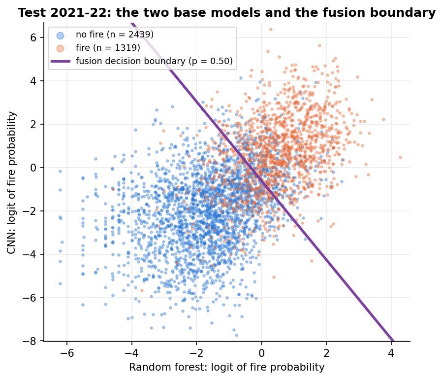
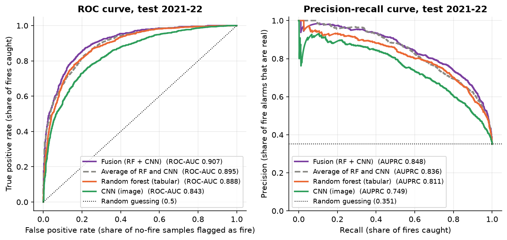
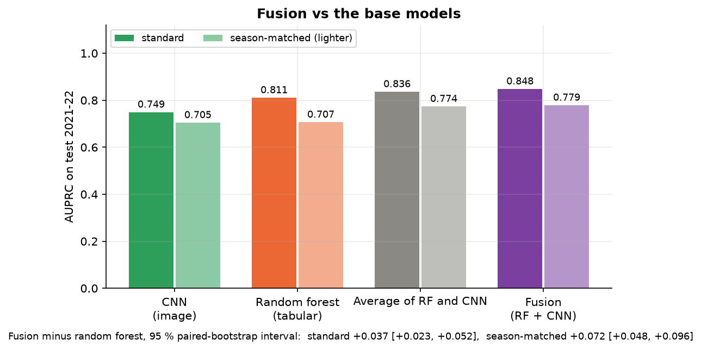

# Fusion: combining the random forest and the CNN

The last step of the plan in `docs/model_plan.md`: a small **logistic-regression meta-learner**
that combines the random forest's fire probability (tabular drivers) with the CNN's fire
probability (Sentinel-2 tile) into one prediction. Same samples, years and metrics as
`reports/tabular/README.md` and `reports/cnn/README.md`.

> **In one paragraph.** On the 2021-22 test years fusion reaches **AUPRC 0.853** (ROC-AUC 0.911,
> F1 0.766), above the random forest alone (0.811) and the CNN alone (0.760). Season-matched it
> keeps **AUPRC 0.782**, against 0.707 for the random forest: the gain from adding the image
> **nearly doubles** once the "fire season" shortcut is removed (+0.042 → +0.075). A paired bootstrap
> over the test samples puts both gains clearly above zero (95 % intervals [+0.031, +0.053] and
> [+0.057, +0.094]). The meta-learner trusts the random forest more (weight 1.79 against 1.25 per
> standard deviation), but both weights are large, so the image adds information the 27 drivers
> do not have. A plain average of the two probabilities already gets almost all of the gain
> (0.849); learning the weights adds little.

> **CNN input since 13 Nov.** `p_cnn` is now the average of five CNN trainings (stopping epoch
> from a held-out year, see `reports/cnn/README.md`) instead of one training. Fusion was re-run
> on it; the code is unchanged.

## 1. Files and how to reproduce

| File | What it is |
|---|---|
| `metrics.csv` | Test scores of fusion, the simple average, RF and CNN, `standard` and `season_matched` |
| `meta_learner.json` | Chosen input scale and C, CV AUPRC on 2020, threshold, intercept and the two weights |
| `cv_results.csv` | Every setting tried in the 2020 cross-validation |
| `bootstrap.csv` | Fusion AUPRC minus RF / CNN AUPRC on test: mean and 95 % paired-bootstrap interval |
| `predictions.csv` | `p_rf`, `p_cnn`, `p_fusion` per `sample_id`; for 2020 `p_fusion` is out-of-fold |
| `figures/` | The figures below |

```bash
python -m forest_fire_risk.fusion           # ~10 s, needs only reports/tabular/ and reports/cnn/predictions.csv
python -m forest_fire_risk.fusion_figures   # figures
```

Code: `src/forest_fire_risk/fusion.py`, `fusion_figures.py`; tests in `tests/test_fusion.py`.
Interactive companion: `notebooks/fusion.ipynb` (source `notebooks/fusion.py`, jupytext); every
cell runs without the raw data, tiles or GPU.
No raw data, tiles or GPU are needed: fusion only reads the two committed prediction files.

## 2. Data and years

- **Inputs:** `p_rf` from `reports/tabular/predictions.csv` and `p_cnn` from
  `reports/cnn/predictions.csv`, joined on `sample_id`. The loader checks that both files hold
  exactly the same samples with the same label and split (2,098 in 2020, 3,758 in 2021-22).
- **Why 2020 (stacking without leakage):** neither base model was fitted or tuned on 2020, so
  their 2020 probabilities are as honest as their test probabilities. If the meta-learner were
  trained on predictions for samples the base models had already seen, those predictions would
  look better than they really are and the meta-learner would trust them too much.

| Years | Role here |
|---|---|
| 2017-2019 | not used (the base models were trained on it) |
| 2020 | fit the meta-learner; 5-fold stratified CV picks its settings and threshold |
| 2021-2022 | test, scored once at the end |

## 3. The model, step by step

For each sample the base models give two probabilities, $p_{rf}$ and $p_{cnn}$.

1. **Logit (optional).** $\text{logit}(p) = \log\frac{p}{1-p}$ maps $(0,1)$ to $(-\infty,\infty)$.
   The CNN outputs probabilities very close to 0 and 1 (as low as $8\cdot10^{-5}$), so on the
   probability scale its strong opinions get squashed against the ends. Probabilities are clipped
   to $[10^{-6}, 1-10^{-6}]$ first.
2. **Standardise** each input with the mean and standard deviation from 2020: $z = (v - \mu)/\sigma$.
3. **Logistic regression with an L2 penalty:**
   $$p_{final} = \sigma(w_0 + w_{rf}\, z_{rf} + w_{cnn}\, z_{cnn}), \qquad \sigma(t) = \frac{1}{1+e^{-t}}$$
   Because the inputs are standardised, $w_{rf}$ and $w_{cnn}$ are both "change in log-odds of
   fire per standard deviation of that model's output" and can be compared directly.
4. **Tuning.** 5-fold stratified cross-validation inside 2020, scored by AUPRC, over the input
   scale (probability or logit) and $C \in \{0.001, \dots, 100\}$ ($C = 1/\lambda$). Then refit on all of 2020.
5. **Threshold.** The F1-maximising cut-off on the out-of-fold 2020 predictions (same rule as the
   tabular models). The test set is not used for any choice.

**What was chosen.** Logit inputs win in every setting (CV AUPRC 0.891 against 0.889 for raw
probabilities). $C$ barely matters (all scores within 0.001 of each other; $C = 0.1$ is best), which is
expected with only two inputs and 2,098 samples. Threshold 0.50. Re-running with four different
CV seeds gives test AUPRC 0.852-0.853 every time.

$$p_{final} = \sigma(-1.27 + 1.79\, z_{rf} + 1.25\, z_{cnn})$$

**Two comparison points:** the random forest and the CNN alone (with the thresholds from their
own reports, picked on 2017-19), and the **simple average** $(p_{rf} + p_{cnn})/2$: a fusion
that learns nothing, with its threshold picked on 2020. It shows how much of the gain comes
from combining at all and how much from learning the weights.



**Figure 1.** Every test sample at (RF logit, CNN logit), coloured by the true label. Fires
(orange) sit top-right, non-fires (blue) bottom-left, but each axis alone leaves a wide overlap.
The purple line is where fusion's probability equals its threshold. It is tilted: a sample the
random forest is unsure about (logit around 0) gets classified by the image, and a very
confident CNN can outvote a lukewarm random forest. A vertical line would be "RF only".

## 4. Results on the test years 2021-22

| Model | AUPRC | ROC-AUC | F1 | Precision | Recall | AUPRC season-matched | ROC-AUC season-matched | F1 season-matched |
|---|---|---|---|---|---|---|---|---|
| **Fusion (RF + CNN)** | **0.853** | **0.911** | **0.766** | **0.766** | 0.765 | 0.782 | 0.858 | 0.701 |
| Average of RF and CNN | 0.849 | 0.906 | 0.764 | 0.751 | 0.776 | **0.786** | **0.859** | **0.705** |
| Random forest | 0.811 | 0.888 | 0.747 | 0.707 | 0.791 | 0.707 | 0.815 | 0.662 |
| CNN (average of 5 trainings) | 0.760 | 0.850 | 0.696 | 0.617 | **0.798** | 0.723 | 0.821 | 0.659 |

The test set has 3,758 samples (1,319 fires); random guessing gives AUPRC 0.351.



**Figure 2.** ROC (left) and precision-recall (right) curves on the test set. Fusion is on top
almost everywhere. At the same recall as the random forest (79 %), fusion's alarms are real
75 % of the time against 71 %.



**Figure 3.** Test AUPRC, plain (dark) and season-matched (light), with the bootstrap interval
for fusion minus the random forest.

**Is the gain real?** A paired bootstrap resamples the 3,758 test samples with replacement
2,000 times and recomputes "fusion AUPRC minus base-model AUPRC" on each resample (season
weights recomputed each time):

| Fusion minus | Standard: mean [95 % interval] | Season-matched: mean [95 % interval] |
|---|---|---|
| Random forest | +0.042 [+0.031, +0.053] | +0.075 [+0.057, +0.094] |
| CNN | +0.092 [+0.077, +0.108] | +0.059 [+0.037, +0.080] |

Fusion is ahead in 100 % of the resamples in all four cases.

**Reading the numbers.**
- **The two branches are complementary.** Their predictions correlate only moderately
  (0.67 on 2020, 0.62 on test), so they often disagree, and the meta-learner gives both a large
  weight. Neither model is redundant.
- **The image matters more once the season shortcut is gone.** Season matching costs the random
  forest 0.104 AUPRC but fusion only 0.071, and the gain over the random forest grows from +0.042
  to +0.075. This matches the CNN report: the tabular drivers partly encode "what month is it"
  (temperature, radiation), while the tile mostly encodes "what kind of place is this" (fuel,
  vegetation, terrain), which is the part of fire danger the season does not explain.
- **The random forest still carries most of the weight** (1.79 vs 1.25), as expected: it is the
  stronger single model and it sees the weather of the day before, which the image cannot.
- **Where fusion changes the decision.** At their own thresholds, fusion raises 124 fewer false
  alarms than the random forest (308 vs 432) and catches 34 fewer test fires (1,009 vs 1,043).
  Of the 286 samples the random forest flags and fusion clears, 64 % are correctly cleared; the
  128 opposite switches are right 55 % of the time (`notebooks/fusion.ipynb`, section 6). Part of
  this is just the thresholds (fusion 0.50, RF 0.41); at equal recall fusion is more precise
  (Figure 2).
- **Most of the gain is in combining at all.** The plain average gets 0.849, about nine tenths
  of the way from the random forest to fusion; the learned weights and the logit scale add
  another 0.004. Season-matched the plain average is even slightly ahead (0.786 vs 0.782), so
  the two are level within noise.

## 5. Limitations

- **The bootstrap covers test-sample noise, not training noise.** Single CNN trainings differ by
  about ±0.02 AUPRC (`reports/cnn/README.md`, section 3). The CNN input is now the average of
  five trainings, which was stable to about ±0.002 between two complete runs, so this matters
  much less than before. Refitting fusion on each single training
  (`reports/cnn/predictions_runs.csv`) would show the spread directly; that is still to do.
- **One year to fit the meta-learner.** 2020 is a single fire season (2,098 samples); the
  meta-learner has only three parameters, so this is enough to fit it, but its weights reflect
  how the base models behaved in that one year.
- **2020 looks easier than 2021-22** (CV AUPRC 0.891 on 2020 vs 0.853 on test), so the
  threshold picked on 2020 may not be the best one for later years. AUPRC and ROC-AUC do not
  depend on the threshold; F1, precision and recall do.
- **Late fusion only.** The meta-learner sees two numbers, not the features or pixels. A model
  that learns from both inputs jointly (e.g. CNN features concatenated with the tabular
  features) could find interactions this cannot, at the cost of the clean "how much does each
  branch count" reading.
- **Same caveats as the base models:** next-day danger only (tabular inputs from the day before the fire), the same cells
  can appear in train and test years, season bias handled at evaluation time only.
