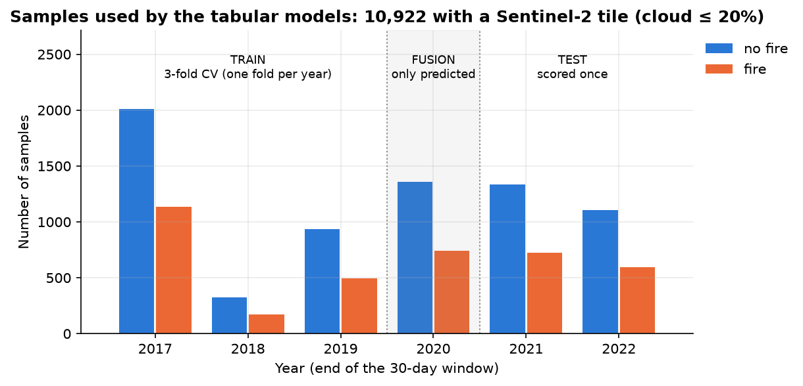
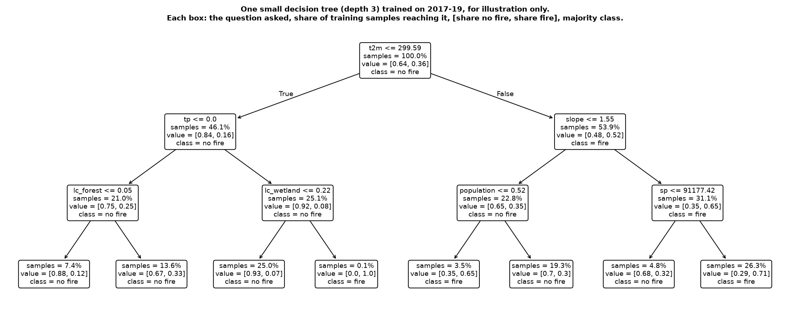
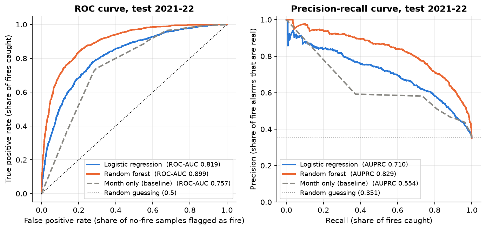
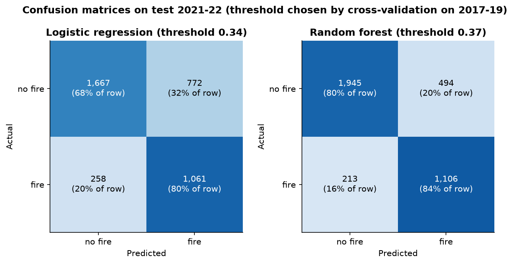
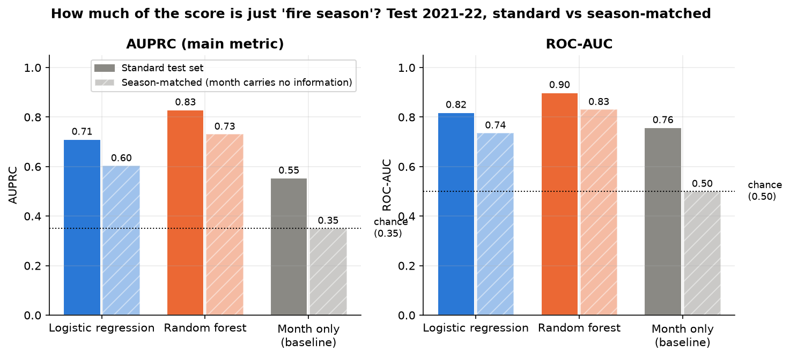
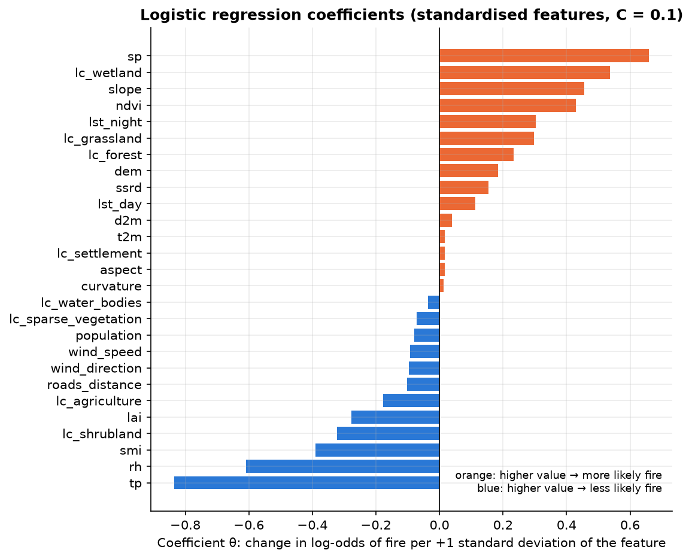
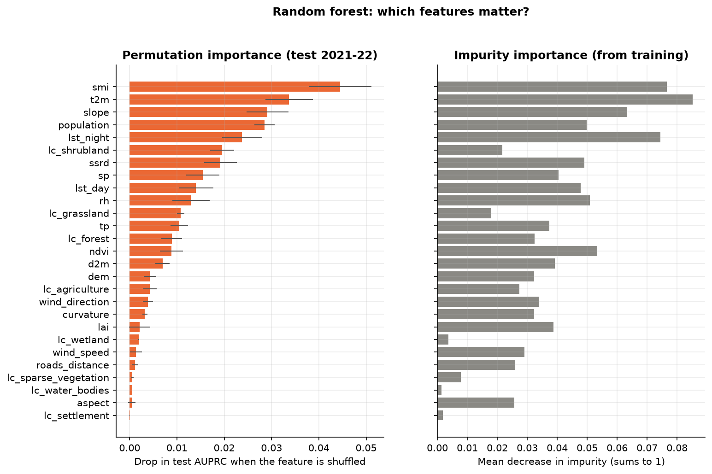
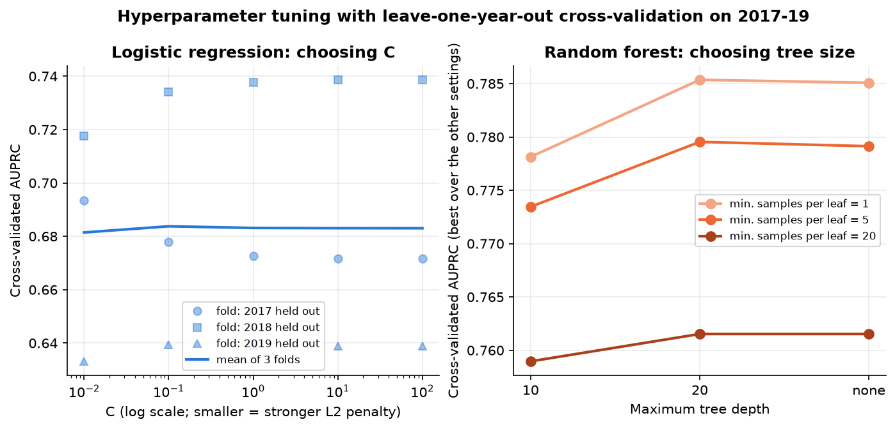
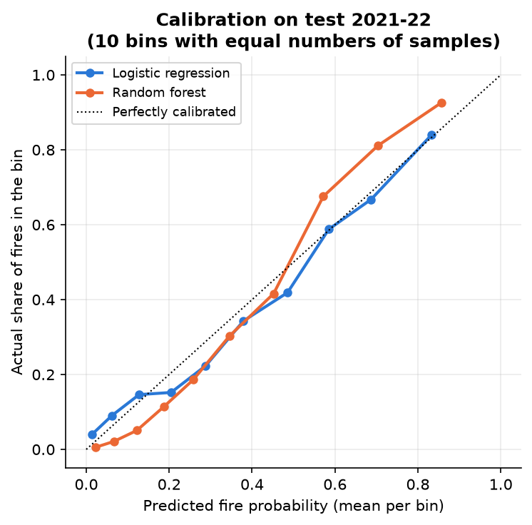
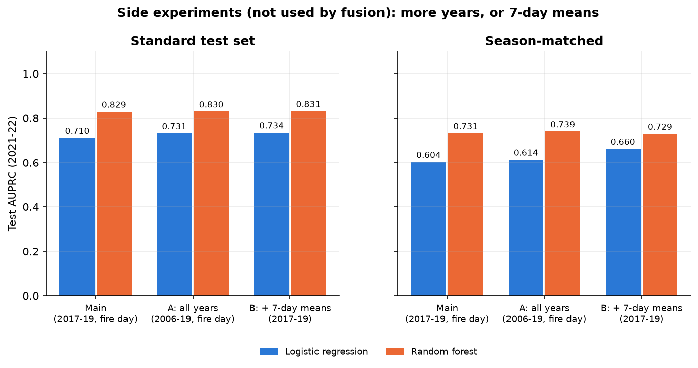

# Tabular models: logistic regression and random forest

Results of the tabular branch of the project: a **logistic regression** baseline and a
**random forest**, trained on the Mesogeos fire-day features for the samples that also have a
Sentinel-2 tile. This page explains what was done, why, and how to read every figure, so it can
be used directly when writing the project report.

> **In one paragraph.** On the 2021-22 test years the random forest clearly beats logistic
> regression: **AUPRC 0.829 vs 0.710**, ROC-AUC 0.899 vs 0.819, F1 0.758 vs 0.673. Part of both
> scores comes from the seasonal sampling of the dataset (fires in summer, non-fires all year):
> knowing only the month already gives AUPRC 0.554. After removing that effect
> ("season-matched" evaluation) the random forest still reaches **AUPRC 0.731** and logistic
> regression **0.604** (chance = 0.351), so both models learn real fire-danger signal beyond the
> season, and the non-linear model learns more of it. Soil moisture, air temperature, slope,
> population and night-time land temperature drive the random forest most. Neither more years of
> data nor 7-day weather averages change the random forest's score (side experiments).

Contents:
[1. Files](#1-files-and-how-to-reproduce) ·
[2. Data](#2-which-data-the-models-use) ·
[3. Years and cross-validation](#3-how-each-year-is-used-k-fold-cross-validation-and-why-2020-is-untouched) ·
[4. The models](#4-the-two-models) ·
[5. Metrics](#5-how-the-models-are-scored) ·
[6. Results](#6-results-on-the-test-years-2021-22) ·
[7. Season bias](#7-the-fire-season-shortcut-and-season-matched-evaluation) ·
[8. What drives the predictions](#8-what-drives-the-predictions) ·
[9. Tuning](#9-hyperparameter-tuning) ·
[10. Calibration](#10-calibration-can-the-probabilities-be-trusted) ·
[11. Side experiments](#11-side-experiments-not-part-of-the-main-pipeline) ·
[12. Hand-off to fusion](#12-hand-off-to-the-fusion-model) ·
[13. Limitations](#13-limitations)

---

## 1. Files and how to reproduce

| File | What it is |
|---|---|
| `metrics.csv` | Test scores per model (`logreg`, `rf`, `month` baseline), `standard` and `season_matched` |
| `predictions.csv` | **For fusion.** Fire probability from LR (`p_logreg`) and RF (`p_rf`) for every 2020 (`split = val`) and 2021-22 (`split = test`) sample, by `sample_id` |
| `best_params.json` | Chosen hyperparameters, cross-validated AUPRC and decision threshold per model |
| `cv_results.csv` | Every hyperparameter setting tried, with its score on each cross-validation fold |
| `rf_feature_importance.csv` | Random forest feature importances (permutation and impurity) |
| `side_experiments.csv` | Scores of the side experiments next to the main models (section 11) |
| `figures/` | All figures below (PNG) |

```bash
pip install -e .                                  # once, in the forest-fire-risk conda env
python -m forest_fire_risk.tabular                # tune + train + evaluate, ~2 min
python -m forest_fire_risk.side_experiments       # optional, ~5 min
python -m forest_fire_risk.tabular_figures        # figures, ~20 s
```

Code: `src/forest_fire_risk/tabular.py` (main pipeline), `side_experiments.py`,
`tabular_figures.py`; tests in `tests/test_tabular.py`. Fitted models are saved to
`models/tabular/` (not in git; re-run the first command to recreate them). Everything is seeded,
so re-running gives the same numbers.

## 2. Which data the models use

**Samples: the tabular ∩ Sentinel-2 intersection.** Only samples that have a usable Sentinel-2
tile are used, i.e. 2017-2022 (Sentinel-2 starts in 2017). The research question is whether
combining the tabular random forest with the image CNN beats either alone; that comparison is
only fair if all models (LR, RF, CNN, fusion) are trained and tested on exactly the same
samples, and fusion needs both an RF and a CNN prediction for every sample anyway. The price is
that 2006-2016 are not used for training; side experiment A (section 11) shows this costs
nothing measurable.

**Cloudy tiles: dropped above 20 % scene cloud.** Of the 11,579 tiles, 657 come from scenes with
more than 20 % cloud. We drop those samples, and the CNN drops the same 657 tiles (agreed with the
image branch), so all models use exactly the same samples. It is a single setting
(`MAX_CLOUD` in `tabular.py`; `None` keeps all tiles) and re-running takes about two minutes.
Note: the proposal says 644 cloudy tiles; the tile index actually has 657 above 20 %.

**Which samples have a tile** is read from `data/images/index.csv` when it exists. Without the
images, it falls back to `data/tile_index_from_map.csv`, built automatically from the deployed
map's data, which is generated from the same `index.csv` (same 11,579 / 414 counts).

**Features: the 27 values on the fire day** (day 29 of the 30-day window): 13 dynamic (weather,
land-surface temperature, vegetation, soil moisture) and 14 static (terrain, land cover,
population, distance to roads); see Table 1 of the proposal. The label-leaking columns
`burned_areas`, `ignition_points`, `burned_area_has` are never used.



**Figure 1.** Samples per year and class after the intersection (10,922 samples). Shading shows
how each year is used (next section). Fires make up about one third of every year. 2018 is small
because Mesogeos Track A itself has few samples that year (545 before the intersection, 495 after).

| Split | Years | No fire | Fire | Total |
|---|---|---|---|---|
| Train | 2017-2019 | 3,267 | 1,799 | 5,066 |
| Fusion (val) | 2020 | 1,357 | 741 | 2,098 |
| Test | 2021-2022 | 2,439 | 1,319 | 3,758 |

## 3. How each year is used: k-fold cross-validation, and why 2020 is untouched

| Years | Role | Used to |
|---|---|---|
| 2017-2019 | train | fit the models; **3-fold cross-validation** picks the hyperparameters and the decision threshold |
| 2020 | fusion only | the final LR / RF only *predict* it; the fusion model is trained on those predictions. **Never used to fit or tune LR / RF** |
| 2021-2022 | test | touched once, at the end, for every reported score |

**Why 2020 must stay untouched.** The fusion model learns how much to trust each base model from
their predictions on 2020. Those predictions are only honest if 2020 had no influence on the
base models. If we had chosen `C`, the tree depth or the threshold by looking at 2020 scores,
the 2020 predictions would look slightly better than they really are, and fusion would learn to
over-trust them. For the same reason the base models are *not* retrained with 2020 included.

**Cross-validation: leave-one-year-out (k = 3).** All tuning happens inside 2017-2019 with
k-fold cross-validation, where each fold is one year: train on two years, validate on the third,
rotate, and average the three validation scores.

- *Why folds by year and not random 5-fold?* Neighbouring 1 km cells burned by the same fire on
  the same day are separate samples with almost identical weather. A random split would put some
  in training and some in validation; the model would "recognise" the fire and the
  cross-validation scores would be too optimistic. Splitting by year rules that out, and it
  copies the real test (predicting years the model has never seen).
- *Hyperparameters:* every candidate setting is scored by its mean AUPRC over the 3 folds; the
  best one wins (section 9).
- *Decision threshold:* every 2017-2019 sample gets an **out-of-fold** prediction, made by the
  fold model that did not train on its year. The threshold that maximises F1 on these
  out-of-fold predictions is used, unchanged, on the test set.
- *Final model:* refit once on all of 2017-2019 with the chosen settings. That one model makes
  the 2020 predictions (for fusion) and the 2021-22 predictions (for the test).

## 4. The two models

Both models get the same 27 features and output a fire probability between 0 and 1. Missing
values (mainly land-surface temperature on cloudy days) are filled with the training median.
No missing-value indicator is added, so the model cannot learn "missing LST means no fire"
(an artefact of how the dataset was built, see the EDA).

### Logistic regression (baseline)

Exactly the model from the class lab: p̂ = σ(θ₀ + θᵀx), with σ the sigmoid, fitted by
minimising the cross-entropy loss plus an L2 penalty λ‖θ‖². In scikit-learn
`LogisticRegression(C=...)`, where C = 1/λ: **smaller C = stronger regularisation**.
Features are standardised first (mean 0, standard deviation 1, fitted on training data only), so
each coefficient θⱼ means "change in log-odds of fire when feature j rises by one standard
deviation" and coefficients can be compared with each other. L2 is there because several
features are strongly correlated (the temperature family, pressure with elevation, NDVI with
LAI), which otherwise makes coefficients unstable. Chosen by cross-validation: **C = 0.1**.

Its limitation: the decision boundary is a straight line (a hyperplane) in feature space, so it
cannot express "fire if hot **and** dry **and** forested" unless such combinations are added
by hand.

### Random forest: how it works

**A decision tree** is a flowchart of yes/no questions about the features. Figure 9 shows a small
one trained on our data. A new sample starts at the top box and follows the answers down to a
leaf; the leaf's share of fire samples is the predicted fire probability.



**Figure 9.** A single depth-3 tree trained on 2017-19, for illustration only (the real forest
uses 500 much deeper trees). Read it from the top: the first question is
"`t2m` ≤ 299.6 K?" (air temperature ≤ 26.4 °C). 46 % of training samples answer *yes*, and only
16 % of those are fires; of the 54 % that answer *no* (hotter), 52 % are fires. The hot branch
then asks about `slope` and surface pressure `sp`; the cooler branch asks whether there was any
rain (`tp`). The bottom-right leaf (hot, higher slope value, low-lying, 26 % of samples) is 71 %
fire. Each box shows: the question, `samples` = share of training samples reaching the box,
`value` = [share no fire, share fire] among them, and the majority class.

*How a tree picks its questions.* At each box the algorithm tries every feature and every
cut-off value, and picks the question that best separates fires from non-fires, i.e. that makes
the two resulting groups as "pure" as possible (measured by **Gini impurity**: 0 when a group is
all one class, 0.5 when it is 50/50). It then repeats this inside each group, until the tree
reaches its maximum depth or a group gets too small. Because each question is asked *inside* the
answer to the previous one, trees capture **interactions** automatically ("hot *and* steep *and*
low-lying"), which logistic regression cannot. Trees also don't care about feature scale or
units (a cut-off on Kelvin works like a cut-off on a fraction), so no standardisation is needed,
and correlated features don't destabilise them.

*Why one tree is not enough.* A deep tree can keep splitting until every leaf is pure, i.e. it
memorises the training data, including its noise (overfitting). A small tree avoids that but is
too crude.

*The forest fixes this by averaging many different trees.* Each of the 500 trees is trained on:
1. a **bootstrap sample**: a random sample of the training rows, drawn with replacement (so each
   tree sees a slightly different dataset), and
2. at every box, only a **random subset of the features** is considered for the question (here
   √27 ≈ 5 features).

Both sources of randomness make the trees different from one another, so their individual
mistakes are partly independent. The forest's fire probability is the **average over the 500
trees**, and averaging cancels much of the individual trees' noise while keeping what they agree
on. This is called *bagging* (bootstrap aggregating) plus feature subsampling.

*Hyperparameters tuned (section 9):* `max_depth` (how many questions deep a tree may go),
`min_samples_leaf` (smallest allowed group at a leaf; larger = smoother trees),
`max_features` (how many features each question may choose from), `class_weight` (whether fires
count more, to balance the 1:2 ratio). Chosen: **depth 20, min. 1 sample per leaf,
√27 features per question, no class weighting**, 500 trees.

## 5. How the models are scored

Each model outputs a probability; to say "fire / no fire" we compare it with a **threshold**.

- **Precision**: of the samples flagged as fire, the share that really are fires.
- **Recall**: of the real fires, the share that were flagged.
- **F1**: the harmonic mean of precision and recall, 2PR/(P+R); one number that is high only if
  both are.
- **ROC-AUC**: the probability that a random fire gets a higher score than a random non-fire
  (0.5 = guessing, 1 = perfect). Threshold-free.
- **AUPRC** (area under the precision-recall curve, *average precision*): the average precision
  over all recall levels. Threshold-free. **Our main metric**, because with only one third fires
  ROC-AUC can look good even when many fire alarms are false; AUPRC punishes that. Guessing gives
  AUPRC = share of fires (0.351 on the test set).

Thresholds were chosen to maximise F1 in cross-validation: **0.34 for LR, 0.37 for RF**. They are
below 0.5 because fires are the minority class; a lower threshold catches more fires (recall)
at a modest cost in precision, which F1 rewards.

The **month-only baseline** predicts, for every sample, the share of fires in that calendar month
in 2017-19 (e.g. August is mostly fires). It uses no weather or terrain at all and shows how far
the season alone gets you; section 7 explains why this matters.

## 6. Results on the test years 2021-22

| Model | AUPRC | ROC-AUC | F1 | Precision | Recall | CV AUPRC (2017-19) |
|---|---|---|---|---|---|---|
| Logistic regression | 0.710 | 0.819 | 0.673 | 0.579 | 0.804 | 0.684 |
| **Random forest** | **0.829** | **0.899** | **0.758** | **0.691** | 0.839 | 0.785 |
| Month only (baseline) | 0.554 | 0.757 | 0.644 | 0.581 | 0.723 | – |
| Random guessing | 0.351 | 0.500 | – | – | – | – |

The test scores are close to (slightly above) the cross-validation scores, so the models were
not over-tuned to the training years.



**Figure 2.** *Left:* ROC curve: for every possible threshold, the share of fires caught (y)
against the share of non-fires falsely flagged (x). A curve closer to the top-left corner is
better; the diagonal is guessing. *Right:* precision-recall curve: for every threshold, how many
alarms are real (y) against how many fires are caught (x); top-right is better, the dotted line
is guessing. The random forest is above logistic regression everywhere; for example, when catching
80 % of fires, 71 % of RF alarms are real, against 58 % for LR. The month-only
baseline's curves are made of straight segments because it can only output 12 distinct values.



**Figure 4.** Test predictions at the chosen thresholds. Rows are the truth, columns the
prediction; percentages are per row. The random forest catches more fires (84 % vs 80 %) **and**
raises far fewer false alarms (494 vs 772 non-fires flagged as fire).

## 7. The "fire season" shortcut and season-matched evaluation

> **Season matching is a way of scoring, not a different model.** Nothing is retrained. There is
> one logistic regression and one random forest; each gets two test scores, *standard* and
> *season-matched*. Fusion uses this same random forest (`p_rf`), and fusion should also be
> scored both ways.

**Step 1: the dataset has a quirk.** A real fire happens when it happens, and that is mostly in
summer. The no-fire samples were picked by the dataset's creators fairly evenly across March-October,
with a few in every other month.
In the test years 2021-22:

| | July-August | April |
|---|---|---|
| Fire samples | 953 (72 % of all test fires) | 7 |
| No-fire samples | 686 (28 % of all test non-fires) | 270 |

So a random August sample is a fire about 6 times out of 10, an April sample about 3 times out of
100. You would guess well from the date alone. This is an artefact of how the dataset was built:
in reality there are plenty of non-fire days in August, the dataset just does not contain many.

**Step 2: the month-only baseline measures exactly that.** It is a deliberately simple "model"
that ignores weather, terrain and everything else. Its only rule is: *the chance of fire is the
share of fires in this calendar month in 2017-19*. It still reaches **AUPRC 0.55**, where blind
guessing gets 0.35. That 0.55 is what you get for free from the calendar. It is a yardstick, like
the logistic regression baseline: if the random forest scored only 0.56, it would have learned
almost nothing beyond the calendar. It scores 0.83.

**Step 3: why our models can use this shortcut.** Month is *not* one of the features, but
temperature, solar radiation, vegetation and others all reveal the season. A model can learn
"hot and sunny → summer → in this dataset, probably fire". That is a pattern of the sampling, not
of fire danger. What fire-danger maps actually need is to tell *which* places will burn when
every place is hot, i.e. an August fire from an August non-fire. Because the test set has
relatively few August non-fires, the standard score measures that skill only weakly.

**Step 4: season-matched evaluation removes the shortcut.** We re-weight the test non-fires so
that, together, they have the same month mix as the fires: a July or August non-fire counts about
2.5 times, an April non-fire about 0.05 times (fires keep weight 1; the total weight of the
non-fires is unchanged, so chance stays at 0.351). It is as if the test set had been built
fairly, every fire compared against non-fires from the same time of year. (We re-weight instead
of throwing away non-fires: there are fewer July-August non-fires than fires, so real
subsampling would discard most of the test set.) Code: `season_weights` in `tabular.py`.

Now the month says nothing about the label. The check that this works: the month-only baseline
drops to **ROC-AUC 0.500 exactly**, a coin flip, and AUPRC 0.351, chance.



**Figure 3.** Solid bars: standard test set; hatched bars: season-matched. Dotted line: chance.

| Model | AUPRC standard | AUPRC season-matched | ROC-AUC standard | ROC-AUC season-matched |
|---|---|---|---|---|
| Logistic regression | 0.710 | 0.604 | 0.819 | 0.736 |
| Random forest | 0.829 | 0.731 | 0.899 | 0.831 |
| Month only | 0.554 | 0.351 (= chance) | 0.757 | 0.500 (= chance) |

**How to read it.**
- *Random forest 0.83 → 0.73:* about 0.10 AUPRC of its standard score came from recognising the
  season. The remaining 0.73, far above the 0.35 chance level, is genuine skill: telling a
  fire day from a non-fire day *within the same part of the year*.
- *Logistic regression 0.71 → 0.60:* the same kind of drop, still clearly above chance.
- The gap between the two models (≈0.12 AUPRC) is the same under both scorings, so the random
  forest's advantage is not a seasonal artefact.

**Suggested sentence for the project report:** *"Part of the scores reflects the dataset's
seasonal sampling: the month alone gives AUPRC 0.55. Under a season-matched evaluation the random
forest keeps AUPRC 0.73 against 0.35 for chance, so it detects fire danger within the fire season,
not just the season itself."*

**Not done (possible extension):** training a model that *cannot* use the shortcut, e.g. by
applying the same re-weighting to the training data. The proposal only commits to reporting
results with and without season matching, which is what is done here.

## 8. What drives the predictions



**Figure 5.** Logistic regression coefficients on standardised features: how much the log-odds of
fire change when the feature rises by one standard deviation, all else equal (exp(θ) is the
factor on the odds). Orange pushes towards fire, blue away from it.

- The clearest signals are the **wetness** variables: more precipitation (`tp`, odds × 0.43 per
  SD), higher humidity (`rh`, × 0.54) and higher soil moisture (`smi`, × 0.68) all make fire less
  likely, as expected.
- Surface pressure `sp` has the largest positive weight (× 1.93). Pressure is mostly a proxy for
  **low elevation** (it correlates strongly with `dem`): lowland and coastal cells burn more.
- **Caution with correlated features.** Air temperature `t2m` gets a coefficient near zero even
  though it is one of the strongest single drivers (Figure 6, and the first question of the tree
  in Figure 9). Its information is shared with `lst_night`, `lst_day` and `d2m`, and L2 spreads
  the weight across the group. So individual LR coefficients should be read as "given all the
  other features", not as the importance of the feature alone.
- `lc_wetland` and `slope` should not be over-interpreted: wetland cover is near zero for almost
  all cells, and `slope` is the feature the EDA found to be mis-scaled.



**Figure 6.** *Left (main):* **permutation importance**: how much the test AUPRC drops when one
feature's values are randomly shuffled (breaking its link to the label) while the others stay
intact; error bars are the spread over 10 shuffles. *Right:* **impurity importance**: how much
each feature's questions reduced Gini impurity during training (sums to 1). Impurity importance
is known to favour features with many distinct values, so the permutation version is the one to
quote.

- Top five: **soil moisture (`smi`)**, **air temperature (`t2m`)**, `slope`, **population**
  and night-time land temperature (`lst_night`). Dryness and heat dominate, as the EDA suggested;
  population plausibly reflects human ignitions.
- The importances are spread out: no single feature is worth more than ~0.045 AUPRC on its own,
  partly because correlated features can stand in for each other when one is shuffled.
- `slope` ranks high in both models despite being mis-scaled (values in a narrow 1.44-1.57 band).
  Its value may act as a proxy for location/region rather than steepness; worth checking before
  claiming "steep slopes burn".

## 9. Hyperparameter tuning



**Figure 7.** Cross-validated AUPRC (leave-one-year-out on 2017-19) for each setting. *Left:*
logistic regression for C from 0.01 to 100; markers are the three folds (which year was held
out), the line their mean. The choice barely matters (mean 0.682-0.684); C = 0.1 is best by a
hair. The fold-to-fold spread (0.63-0.74) is much larger than the effect of C: some years are
simply harder to predict than others. *Right:* random forest, best score for each tree depth and
leaf size (over the other two settings). Deeper trees and smaller leaves help slightly, but the
whole range is only 0.76-0.785 (note the zoomed y-axis): the random forest is not very sensitive
to these settings.

## 10. Calibration: can the probabilities be trusted?



**Figure 8.** The test samples are sorted by predicted probability into 10 equal-sized bins. For
each bin: average predicted probability (x) against the actual share of fires (y). On the dotted
diagonal, "70 % fire" really means 70 % of such samples burn. Logistic regression is well
calibrated. The random forest is slightly *under-confident* at the top (samples it gives
~0.57 burn ~68 % of the time) and *over-confident* at the bottom. This matters for fusion, which
combines the two branches' probabilities; the logistic-regression meta-learner re-scales its
inputs, so mild mis-calibration is acceptable.

## 11. Side experiments (NOT part of the main pipeline)

> These are extra "what if" experiments for the discussion section of the report. Their models
> are **not saved and are not used by the fusion model**; `predictions.csv` contains only the
> main models above. Code: `src/forest_fire_risk/side_experiments.py`, results:
> `side_experiments.csv`. Both are scored on exactly the same 2021-22 test samples as the main
> models.

- **A. All training years.** Train on every Track A year 2006-2019 (19,504 samples, tabular only,
  no image needed) instead of the 2017-19 intersection (5,066). *Question: does restricting the
  tabular models to the Sentinel-2 years cost accuracy?* Same hyperparameters as the main models;
  leave-one-year-out CV over 14 years picks the threshold.
- **B. 7-day means.** Add the mean of each of the 13 dynamic drivers over the last 7 days of the
  window (40 features). *Question: does the build-up before the fire day (the EDA showed fire and
  non-fire conditions drift apart over the last ~10 days) add signal beyond the fire day itself?*
  Tuned from scratch with the same grids and cross-validation.



**Figure 10.** Test AUPRC of the main models and the two side experiments.

| | LR AUPRC | RF AUPRC | LR season-matched | RF season-matched |
|---|---|---|---|---|
| Main (2017-19, fire day) | 0.710 | 0.829 | 0.604 | 0.731 |
| A: all years (2006-19) | 0.731 | 0.830 | 0.614 | 0.739 |
| B: + 7-day means | 0.734 | 0.831 | 0.660 | 0.729 |

**Findings.**
- **A:** almost four times more training data leaves the random forest unchanged (0.829 → 0.830)
  and helps logistic regression only a little. So using the intersection costs essentially
  nothing, which supports the decision in section 2.
- **B:** the 7-day means help **logistic regression** noticeably, especially season-matched
  (0.604 → 0.660), but not the random forest. A plausible reading: the averages give the linear
  model a smoother "has it been hot and dry for a while" signal that it cannot build itself,
  while the forest already extracts that information from the fire-day values and their
  interactions.

## 12. Hand-off to the fusion model

- Use `reports/tabular/predictions.csv`, column **`p_rf`** (the proposal's fusion uses RF + CNN;
  `p_logreg` is included for completeness). Join to the CNN predictions on `sample_id`.
- Rows with `split == "val"` (2020) are for **training** the fusion meta-learner; rows with
  `split == "test"` (2021-22) are for **evaluating** it. The RF never trained or tuned on either.
- The CNN must use the **same samples** (tile available, scene cloud ≤ 20 %) and must also be
  trained on 2017-19 only; otherwise fusion's 2020 inputs are not comparable.
- Fusion also needs its own decision threshold, which must not come from the test set; one
  option is cross-validation within 2020.
- Report fusion with the same metrics, both standard and season-matched (`season_weights` in
  `tabular.py`). There is no separate "season-matched model": it is the same `p_rf`, scored two ways.

## 13. Limitations

- **Cloudy tiles (decided).** Tiles above 20 % scene cloud are dropped by both the tabular
  models and the CNN. The reason: the cloudy tiles are 571 non-fires and only 86 fires (fire
  days are cloud-free by construction, see the EDA), so cloud cover itself is a hint about the
  label and a CNN could learn "clouds → no fire". The image branch checked that, among the
  remaining tiles, the CNN still separates fires from non-fires within each cloud level
  (ROC-AUC 0.78-0.85 per level; details in `reports/cnn/README.md`).
- **Same-day danger, not a forecast.** The features include the fire day itself, so the models
  estimate danger on a given day rather than predicting fires days ahead.
- **Not every split is by location.** Years are separated, but the same 1 km cells can appear in
  training and test years. Static features (terrain, land cover) can therefore partly identify
  places that burn repeatedly.
- **Season bias** is handled at evaluation time (section 7), not at training time; the models
  themselves are trained on the dataset's natural (seasonally biased) sampling.
- Small training set: 5,066 samples in three years, with only 495 in 2018. Side experiment A
  suggests this is not limiting for the random forest.
